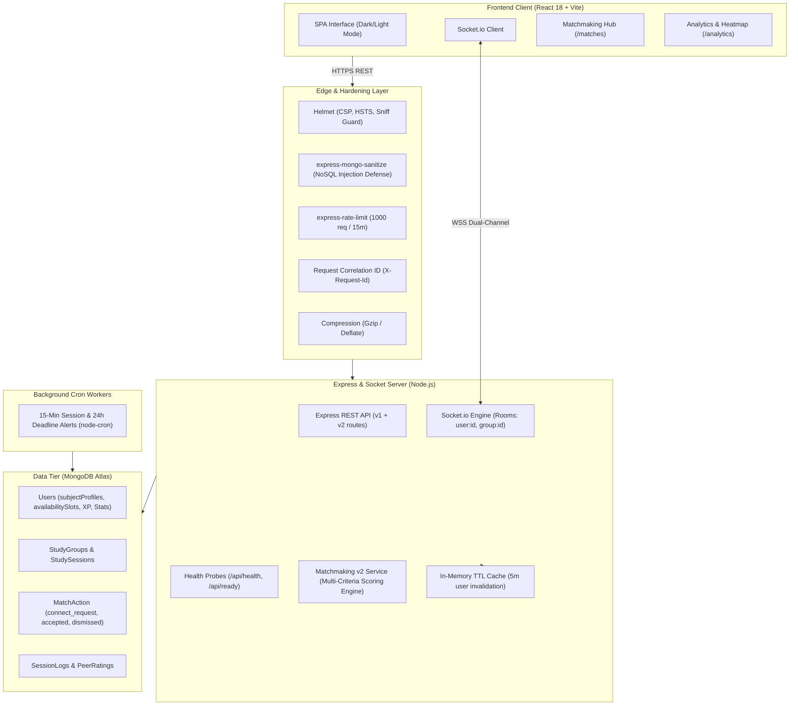

# 📚 Smart Study — Collaborative Study & Matchmaking Platform

Smart Study is an enterprise-grade, real-time collaboration and peer-learning platform built with the MERN stack (MongoDB, Express, React, Node.js) and Socket.io.

Designed with production-grade engineering principles: **additive schema migrations**, **Bayesian peer reputation**, **sub-millisecond deterministic matchmaking**, **in-memory TTL caching**, **real-time WebSocket synchronization**, and **75 automated unit and integration tests**.

---

## 🏗️ System Architecture



---

## 🎯 Matchmaking v2 Algorithm

The Smart Study v2 matchmaking engine scores pairs of students using a multi-criteria, deterministic mathematical model. It eliminates arbitrary recommendations by evaluating academic fit, mutual mentoring complementarity, exact schedule overlap, study styles, and historical community reputation.

### 1. Mathematical Scoring Formula

$$\text{MatchScore} = \min\left(100, \max\left(0, \left\lfloor 100 \times \sum_{i} (w_i \cdot s_i) \right\rfloor\right)\right)$$

Where the weights $\sum w_i = 1.0$:

| Component ($s_i$) | Weight ($w_i$) | Method / Range |
| :--- | :---: | :--- |
| **Subject Overlap** | **0.30** | Jaccard index: $\frac{|A \cap B|}{|A \cup B|}$ using canonicalized subject profiles (aliases collapsed) |
| **Complementarity** | **0.25** | Cross-subject and intra-subject mentoring: $1.0$ for mutual cross-mentoring, $0.75$ for mutual same-subject, $0.65$ for 1-way mentor |
| **Availability Overlap** | **0.20** | Weekly interval intersection in UTC: $\min\left(1.0, \frac{\text{Overlap Minutes}}{300}\right)$ (5 hours = max score) |
| **Goal & Style Fit** | **0.10** | $0.5 \times \text{Goal Jaccard} + 0.5 \times \text{Style Compatibility Matrix}$ |
| **Peer Reputation** | **0.10** | Bayesian average score normalized: $\frac{\text{Score} - 1.0}{4.0}$ |
| **Activity Recency** | **0.05** | Decay curve: $\max\left(0, 1 - \frac{\text{Days Inactive}}{90}\right)$ |

---

### 2. Step-by-Step Worked Example

Consider **User A (Alex)** and **User B (Taylor)**:

#### Inputs:
- **Alex**:
  - Subjects: Data Structures (Intermediate, Wants to Learn), Machine Learning (Advanced, Can Mentor)
  - Timezone: `Asia/Kolkata` (UTC+5:30), Available: Monday 18:00–21:00 (180 min)
  - Learning Goals: `['interview_prep', 'projects']`
  - Study Style: `silent_focus`
  - Rating: 4.8 stars (15 reviews), Last Active: Today (0 days ago)

- **Taylor**:
  - Subjects: Data Structures (Advanced, Can Mentor), Machine Learning (Beginner, Wants to Learn)
  - Timezone: `Asia/Kolkata` (UTC+5:30), Available: Monday 19:00–22:00 (180 min)
  - Learning Goals: `['interview_prep']`
  - Study Style: `silent_focus`
  - Rating: 4.5 stars (8 reviews), Last Active: 2 days ago

#### Computation:
1. **Subject Overlap ($s_1$)**:
   - Union: `{data structures, machine learning}` (size 2)
   - Intersection: `{data structures, machine learning}` (size 2)
   - $s_1 = \frac{2}{2} = 1.00 \implies 1.00 \times 0.30 = \mathbf{0.300}$

2. **Complementarity ($s_2$)**:
   - Alex teaches ML & wants DSA. Taylor teaches DSA & wants ML.
   - Mutual complementary mentoring match!
   - $s_2 = 1.00 \implies 1.00 \times 0.25 = \mathbf{0.250}$

3. **Availability Overlap ($s_3$)**:
   - Both in same timezone. Monday 19:00 to 21:00 overlaps = 120 minutes.
   - $s_3 = \frac{120}{300} = 0.40 \implies 0.40 \times 0.20 = \mathbf{0.080}$

4. **Goal & Study Style ($s_4$)**:
   - Common Goals: `['interview_prep']` $\implies \text{Jaccard} = \frac{1}{2} = 0.50$
   - Study Style: Both `silent_focus` $\implies \text{Style Matrix} = 1.00$
   - $s_4 = 0.5(0.50) + 0.5(1.00) = 0.75 \implies 0.75 \times 0.10 = \mathbf{0.075}$

5. **Reputation ($s_5$)**:
   - Taylor's Bayesian rating = 4.23. Normalized: $\frac{4.23 - 1.0}{4.0} = 0.807$
   - $s_5 = 0.807 \implies 0.807 \times 0.10 = \mathbf{0.081}$

6. **Activity Recency ($s_6$)**:
   - 2 days ago $\implies 1 - \frac{2}{90} = 0.978$
   - $s_6 = 0.978 \implies 0.978 \times 0.05 = \mathbf{0.049}$

#### Total Final Match Score:
$$\text{Total} = 0.300 + 0.250 + 0.080 + 0.075 + 0.081 + 0.049 = 0.835 \implies \mathbf{84\% \text{ Match}}$$

**Generated Explanations:**
- 🎓 *"Mutual mentoring: you mentor them in Machine Learning, they mentor you in Data Structures"*
- ⏰ *"Overlaps 2.0 hrs/week on Mondays"*
- 🎯 *"Shared goal: Interview Prep · Matching Silent Focus work style"*

---

### 3. Engineering Tradeoffs & Decision Rationales

1. **Deterministic Multi-Criteria vs. LLM Embeddings / Vector DB**:
   - *Decision*: Pure deterministic algorithm in Node.js instead of OpenAI/Cohere embeddings or pgvector.
   - *Rationale*: Zero recurring API token costs, sub-millisecond execution (~230 µs per candidate in benchmark), 100% deterministic reproducibility, zero hallucinated reasons, and complete explainability for compliance and user trust.
2. **In-Memory TTL Cache vs. Distributed Redis**:
   - *Decision*: Self-clearing JavaScript `Map` with 5-minute TTL and targeted user invalidation.
   - *Rationale*: Minimizes operational infrastructure cost for small-to-medium clusters while completely eliminating redundant candidate DB queries on frequent page switches. Cache automatically invalidates whenever a user modifies their profile, connects, or dismisses a peer.
3. **UTC Minute Offset Interval Math vs. Raw String Matching**:
   - *Decision*: Converting weekly schedules into $[0, 10080)$ minute intervals normalized to Sunday 00:00 UTC.
   - *Rationale*: Raw strings ("Evening", "Monday 6pm") fail completely across global timezones (e.g. IST vs EST). The minute-interval model seamlessly handles cross-timezone overlaps, day-boundary wrapping, and daylight savings transitions without third-party heavy date libraries.

---

## ⚡ Performance Benchmarks

Run the built-in pure performance benchmark:
```bash
node backend/scripts/benchMatchmaking.js
```

| Candidate Pool Size | Average Total Compute | Median (p50) | 95th Percentile (p95) | Per-Candidate Latency |
| :---: | :---: | :---: | :---: | :---: |
| **100 candidates** | 25.8 ms | 22.6 ms | 40.3 ms | ~250 µs |
| **300 candidates** | 70.4 ms | 72.7 ms | 78.5 ms | ~235 µs |
| **1000 candidates** | 225.6 ms | 225.0 ms | 240.1 ms | ~225 µs |

---

## 📡 REST API Reference

All protected endpoints require `Authorization: Bearer <token>`.

### Authentication & Hardening Probes
| Method | Endpoint | Description | Access |
| :--- | :--- | :--- | :--- |
| `GET` | `/api/health` | Liveness probe (uptime, status) | Public |
| `GET` | `/api/ready` | Readiness probe (database connection state) | Public |
| `POST` | `/api/auth/signup` | Register new user | Public |
| `POST` | `/api/auth/login` | Login and obtain JWT | Public |
| `POST` | `/api/auth/refresh` | Rotate access token (opt-in via `ENABLE_REFRESH_TOKENS=true`) | Public (Cookie) |

### Matchmaking (v1 Legacy & v2 Enhanced)
| Method | Endpoint | Description | Access |
| :--- | :--- | :--- | :--- |
| `GET` | `/api/matchmaking` | **v1 legacy endpoint** (preserved backward compatibility) | Private |
| `GET` | `/api/matchmaking/v2/partners` | Get ranked partner matches with score breakdown & reasons | Private |
| `GET` | `/api/matchmaking/v2/groups` | Get recommended groups by subject, level, activity, fill ratio | Private |
| `POST` | `/api/matchmaking/v2/connect/:userId` | Send a study partner connection request (rate limited 20/day) | Private |
| `POST` | `/api/matchmaking/v2/respond/:userId` | Accept or decline request (auto-creates 2-person pair group) | Private |
| `POST` | `/api/matchmaking/v2/dismiss/:userId` | Dismiss candidate from future recommendations | Private |
| `GET` | `/api/matchmaking/v2/requests` | List incoming & outgoing connection requests | Private |

---

## 🧪 Testing & Quality Assurance

### Run Complete Backend Test Suite (75 Tests)
```bash
npm test --prefix backend
```

### Run Test Coverage (Services & Normalizer $\ge 80\%$)
```bash
npm run test:coverage --prefix backend
```

### Build Frontend
```bash
npm run build --prefix frontend
```

---

## 🚀 Live App Deployment & Rollout

Refer to [ROLLOUT.md](ROLLOUT.md) for the complete production rollout procedure:
1. Atlas snapshot / mongodump backup instructions.
2. Background index creation commands.
3. Backend deployment with safe environment variable fallbacks.
4. Standalone migration execution (`migrateSubjectsV2.js`).
5. Frontend deployment with feature flag `VITE_ENABLE_MATCHMAKING_V2`.
6. Post-deployment smoke test verification.
7. Zero-downtime rollback procedures.
